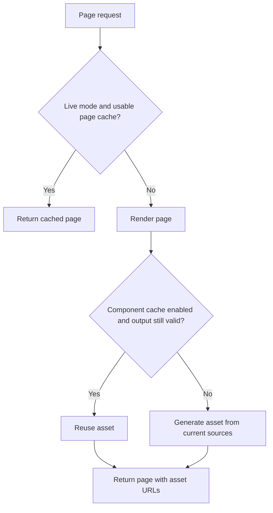

<!-- Generated from docs/ASSET_CACHING.md. Do not edit directly. -->

# Asset caching — esbuild and images

Use `cache: true` on `esbuild`, `image`, or `images` to reuse generated files when
sources are unchanged. When a component renders, it checks its inputs and generates
new output if needed. The default is `cache: false`, which generates on every render.

Page caching is separate: in live mode, HyperBricks can return a cached page
without running its components.

For the relationship between cache layers, see the [caching overview](CACHING.md#cache-layers).
Markdown reuses HTML in memory rather than generated asset files; see
[Markdown caching](MARKDOWN.md#rendering-and-caching) for its settings and source
freshness behavior.



## Development: see changes while reusing unchanged assets

Set your module's `package.hyperbricks.yaml` to watch your source directories:

```yaml
hyperbricks:
  mode: development
  development:
    watch: true
    watch_dirs: [hyperbricks, templates, resources]
```

Development renders the page on each request, so `nocache: true` is not needed.
Refresh your browser after editing: automatic browser refresh is not currently
implemented, including when `development.reload` is `true`.

With component caching enabled:

- Editing an existing JavaScript dependency causes esbuild to rebuild when next
  rendered. A module reload also forces the next esbuild build.
- Editing an image causes it to be regenerated when next rendered. Unchanged
  images remain reusable after a module reload.
- With no changes, generated assets are reused. Reading and checking files still
  happens, but compilation or image transformation is avoided.

Watch reloads YAML and templates as well as the listed resources. Restart the
process after changing package configuration. For esbuild dependency changes
outside the recorded build inputs, see [build validation](ESBUILD.md#build-and-cache-lifecycle).

## Cache JavaScript and give changed builds a new URL

For `resources/js/main.js`, define a component in your module's HyperBricks source:

```yaml
scripts:
  - type: esbuild
  - entry: {path: {base: resources, path: js/main.js}}
  - outfile: {path: {base: static, path: js/app.js}}
  - cache: true
  - fingerprint: true
  - cache_keep: 1
  - enclose: '<script src="|" defer></script>'
```

Use this component in your page's head; see the complete
[JavaScript example](ESBUILD.md#javascript-example).
`cache` avoids rebuilding unchanged inputs. `fingerprint` gives changed output a
new URL so browsers can distinguish versions. `cache_keep: 1` also retains one
previous successful version while the component remains in use.

## Cache an image or a gallery

For `resources/images/team.jpg`:

```yaml
team_photo:
  - type: image
  - src: {path: {base: resources, path: images/team.jpg}}
  - width: 800
  - alt: The project team
  - cache: true
  - cache_keep: 1
  - cache_grace: 1h
```

Place it inside a page or reference it with `inherit`. The image URL changes when
source bytes or transformation settings change. There is no separate image
`fingerprint` switch.

For a gallery, use `type: images` and a `directory` instead of `src`; the same cache
settings apply to each image. See the [gallery example](IMAGES.md#directory-of-images).
Added and changed images are processed when the gallery next renders.

## Live mode: decide when the page must render

A live page can keep serving its cached HTML until expiry or invalidation. During
that time, its components do not run, so editing a source alone does not refresh
the page or its assets.

For a page that must render on every request, set `nocache: true` on that page.
Keep `cache: true` on its asset components to reuse unchanged JavaScript and images.
For example, using the `team_photo` component above:

```yaml
team_page:
  - type: hypermedia
  - route: team
  - nocache: true
  - body:
      - inherit: team_photo
```

A new asset URL does not invalidate cached page HTML. For page-cache expiry and
HTTP behavior, see [Live mode HTTP](LIVE_MODE_HTTP.md). For a static site, rebuild
and deploy the exported HTML and assets together after edits.

## Keeping older files

HyperBricks manages recorded generated files and protects files needed by active
requests, cached pages, and the current static export.

| Setting | Default | What to choose |
| --- | --- | --- |
| `cache_keep` | `0` | Increase it to retain previous successful versions as well as the current one. Applies to esbuild and images. |
| `cache_grace` | `1h` | For images, keep retired versions for at least this time. Choose a longer period if old image URLs remain in use; `0s` removes the time allowance. |

The examples retain one previous version; that is a starting point, not a guarantee
for every deployment. Open browser pages, CDN caches and external APIs may still
use older URLs after HyperBricks stops tracking a reference. Choose retention to
match that lifetime. Cleanup can happen later than the grace period when files
are still protected or the server is idle.

Esbuild has no `cache_grace` setting. Images have both settings: a previous version
can remain because of either its retained-version allowance or its grace period.
Removing a component makes its recorded files eligible for cleanup, subject to
remaining protection and image grace.

For detailed options, see [Native esbuild](ESBUILD.md) and [Images](IMAGES.md).
Generation errors are reported rather than silently returning an old successful
result. If an external API stores image URLs, refresh those references as shown
in [catalog-store](https://github.com/hyperbricks/hyperbricks/blob/v1.3.1-beta/modules/catalog-store/README.md).
